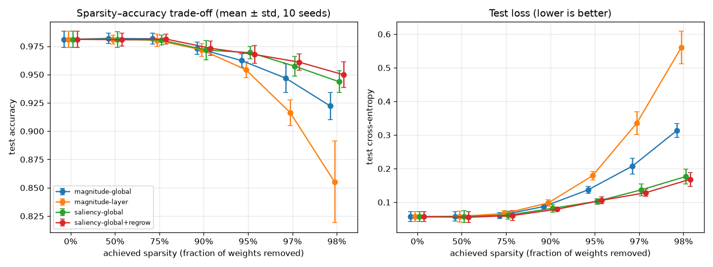

# AQUA — The Self-Pruning Network

A from-scratch reverse-mode autodiff engine in pure Python + NumPy, an MLP trained
with a hand-written Adam optimizer, and a pruning system that removes the network's
least important connections *during* training under a hard sparsity budget.

> **Restrictions honoured:** no PyTorch / TensorFlow / JAX / Keras / HuggingFace or
> any autodiff / pruning / NN library. **scikit-learn is used only to load a standard
> dataset** — never for models, training, or gradients.

## Layout

| Folder    | Contents                                                        |
|-----------|-----------------------------------------------------------------|
| `engine/` | `Tensor`, differentiable ops, backward pass, gradient checking  |
| `nn/`     | Parameters (with masks), layers, MLP, optimizers                |
| `prune/`  | Importance criteria, sparsity schedule, pruner, sparse inference |
| `train/`  | Data loading and the mini-batch training loop                   |
| `tests/`  | Gradient-check suite and masked-weight correctness tests        |
| `scripts/`| One entry point per part of the challenge                       |
| `results/`| Committed raw numbers and plots                                 |

## Install

```bash
uv sync                      # or: pip install -r requirements.txt
```

## Commands

```bash
uv run pytest -v                    # gradient checks + masking tests
uv run python -m scripts.train_dense  # Part 2: dense MLP + Adam on digits (~10 s)
uv run python -m scripts.self_prune   # Part 3: self-pruning to 90% sparsity (~2 s)
uv run python -m scripts.benchmark_cost  # Part 4: MACs, memory, wall-clock of the pruned model
uv run python -m scripts.pareto_sweep    # Part 4: 250-run Pareto sweep + paired statistics (~2-3 min)
```

## Part 2 — dense baseline

`digits` (1,797 8×8 images, 10 classes; loaded with `sklearn.datasets.load_digits`,
the only use of scikit-learn), stratified 60/20/20 train/val/test split, features
standardised with training-set statistics. MLP 64-128-128-10 (ReLU, He init for
hidden layers, Xavier for the logit layer), Adam lr 1e-3, batch 64, 40 epochs, seed 0.

| | value |
|---|---|
| test accuracy | 0.9861 |
| final val accuracy | 0.9583 |
| prunable weights | 25,856 |

Learning curve and raw per-epoch numbers: `results/part2_dense/`.

## Part 3 — self-pruning run

Same model, data and optimizer as Part 2. While training, the network removes its own
connections: dense warm-up for 5 epochs, then one mask update per epoch following a cubic
sparsity ramp to 90% at epoch 30, then 10 epochs of fine-tuning with a fixed mask.

* **Importance criterion:** saliency `S = ½ · E[g²] · w²` — second-order Taylor estimate of
  the loss increase from removing a weight, with the diagonal Fisher (EMA of squared
  gradients w.r.t. the effective weight) standing in for the Hessian. Global ranking across
  layers (scores are in loss units), with a 1% per-layer floor.
* **Regrowth:** a cosine-decaying share (30% → 0) of each event's budget is re-grown from
  previously pruned weights with the largest `|E[dL/dW_eff]|`.
* **Honest masking:** pruned weights are exact zeros in storage and in the forward pass;
  the optimizer holds them at 0 and gives revived weights fresh Adam state.

| seed 0 | dense (Part 2) | self-pruned |
|---|---|---|
| active weights | 25,856 | 2,586 (sparsity 0.9000) |
| test accuracy | 0.9861 | 0.9666 |
| test loss | 0.0505 | 0.0784 |
| final val accuracy / loss | 0.9583 / 0.167 | 0.9694 / 0.112 |

Per-layer density after pruning: 13.9% (64→128), 6.0% (128→128), 36.7% (128→10).
These are single-seed numbers; Part 4 reports means and variance over seeds.

Outputs in `results/part3_self_prune/`: `summary.json` (config, per-epoch history, every
pruning event), `learning_curve.png`, `schedule.png`, `model.npz` (weights + masks).

## Part 4 — does the pruned model actually cost less?

`scripts/benchmark_cost.py` loads the Part 3 model and runs it through a sparse forward
path we wrote (`prune/sparse.py`: CSR storage of the surviving weights, gather–multiply–
segment-sum kernel). The dense-times-mask forward used during training is **not** counted
as a speed-up — it performs every multiplication of the dense model.

| per sample | dense | sparse (CSR) | compacted dense |
|---|---|---|---|
| multiply-accumulates | 25,856 | **2,586 (10.0× fewer)** | 17,443 (1.48× fewer) |
| weight memory | 209 KB | **35 KB (5.9× less)** | 141 KB |
| outputs vs dense model | — | identical (max error 7e-15) | identical |

**Wall-clock, honestly:** on this machine (single-threaded NumPy) our CSR kernel is
**2.7–32× *slower*** than NumPy's dense BLAS matmul, even though it does 10× fewer
multiply-adds. Its time does scale linearly with the number of surviving weights
(R² = 0.99 across densities 2–100%), so the work really shrinks — but irregular gathers
plus an intermediate array cost far more per operation than cache-blocked, vectorised BLAS
on a 64-128-128-10 model. The real wall-clock gain we can show comes from **compaction**:
unstructured pruning disconnected 54 of 256 hidden units; removing them is an exact rewrite
to smaller dense matrices, **1.05–1.35× faster** than the original dense model.
See DESIGN.md for what it takes to turn unstructured sparsity into speed in production.

Raw numbers and machine info: `results/part4_cost/cost.json`; plot: `results/part4_cost/cost.png`.
Timings are machine-dependent; MAC and byte counts are exact.

## Part 4 — Pareto curve and baseline comparison

`scripts/pareto_sweep.py` trains 4 methods × 6 sparsity levels × 10 seeds (+ 10 dense runs)
with the exact Part 3 code, changing only the criterion/scope/regrowth and target sparsity.
Seeds change initialisation and batch order; the data split is fixed. Methods:

* `magnitude-global` — |w|, one ranking across layers (the **stronger** magnitude baseline)
* `magnitude-layer` — |w|, same sparsity in every layer (classic Han et al. style)
* `saliency-global` — ½·E[g²]·w², global (isolates the criterion)
* `saliency-global+regrow` — the full Part 3 method



Mean test accuracy over 10 seeds (std in `results/part4_pareto/summary.csv`):

| sparsity | magnitude-layer | magnitude-global | saliency-global | saliency+regrow |
|---|---|---|---|---|
| 0% (dense) | 0.9811 | 0.9811 | 0.9811 | 0.9811 |
| 50% | 0.9811 | 0.9819 | 0.9811 | 0.9808 |
| 75% | 0.9802 | 0.9816 | 0.9805 | 0.9813 |
| 90% | 0.9719 | 0.9733 | 0.9716 | 0.9733 |
| 95% | 0.9543 | 0.9624 | 0.9694 | 0.9677 |
| 97% | 0.9164 | 0.9468 | 0.9574 | 0.9610 |
| 98% | 0.8552 | 0.9223 | 0.9437 | 0.9499 |

### Is saliency actually better than magnitude? (variance across seeds)

Paired by seed (same init and batch order for both methods), exact sign-flip permutation
test, bootstrap 95% CI, Holm correction across the six sparsity levels. With 10 seeds the
smallest attainable Holm-corrected p is 0.012. Full tables: `results/part4_pareto/comparisons.md`.

**Analysis plan fixed before the sweep:** primary = saliency-global vs magnitude-global,
test accuracy, at 95% sparsity. (Disclosure: an earlier 3-seed exploratory run at 90%/97%
had been looked at while developing Part 3.)

| saliency vs magnitude (global) | Δ accuracy [95% CI] | seeds better | Holm p | Δ test loss | seeds better | Holm p |
|---|---|---|---|---|---|---|
| 90% | −0.17 pts [−0.78, +0.39] | 5/10 | 1.00 | −0.005 | 7/10 | 0.41 |
| **95% (primary)** | **+0.70 pts [+0.19, +1.11]** | 8/10 | **0.16** | −0.034 | 10/10 | 0.012 |
| 97% | +1.06 pts [+0.50, +1.62] | 8/10 | 0.06 | −0.071 | 10/10 | 0.012 |
| 98% | +2.14 pts [+1.20, +3.01] | 9/10 | 0.035 | −0.137 | 10/10 | 0.012 |

Reading it honestly:

* **Up to 90% sparsity there is no measurable difference** — `digits` with this MLP is easy
  enough that any reasonable criterion works.
* **The pre-registered primary test is not significant after correction** (+0.70 pts,
  uncorrected p = 0.039, Holm p = 0.16). We do not claim an accuracy win at 95%.
* **In test loss, saliency is better on every seed at 95%, 97% and 98%** (Holm p = 0.012,
  the floor for 10 seeds), and the accuracy gap grows with sparsity, becoming significant at
  98% (+2.14 pts, Holm p = 0.035).
* **Regrowth** gives no statistically significant improvement over saliency alone at any
  level (best: +0.61 pts at 98%, Holm p = 0.91). We keep it as a feature, not a claim.
* **Global beats layer-wise magnitude** by up to 6.7 pts at 98%: uniform per-layer sparsity
  starves the 1,280-weight output layer.

### Falsifiable claim

> **At 98% sparsity (517 of 25,856 weights kept), saliency pruning (global, no regrowth)
> reaches 94.37% mean test accuracy versus 92.23% for global magnitude pruning, a paired
> difference of +2.14 points (95% CI [+1.20, +3.01]) over 10 seeds, better on 9/10 seeds,
> Holm-corrected p = 0.035; and at 95–98% sparsity its test loss is lower on all 10 seeds.**

It is falsified if re-running `uv run python -m scripts.pareto_sweep` (or adding seeds)
yields a CI for the 98% accuracy difference that includes 0, or any seed at 95–98% where
magnitude has the lower test loss. Raw per-run numbers: `results/part4_pareto/runs.csv`.

**Limitations:** one small dataset (359 test images: 1 image = 0.28 pts), a fixed data split
(seed variance only), one architecture, and CPU-only cost measurements.
